<div align="center">

<picture>
  <source media="(prefers-color-scheme: dark)" srcset=".github/assets/banner-dark.svg">
  
</picture>

**Offline-first writes with explicit conflicts and resumable cursors.**<br>
An idempotent outbox, ordered batches, incremental pulls, tombstones, retry budgets and deterministic conflict policies above PAM Native SQLite and any transport.

[](https://packagist.org/packages/pushinbr/pam-native-sync)
[](https://github.com/push-in/pam-native-sync/releases/latest)

[](https://github.com/push-in/pam-native-sync/actions/workflows/ci.yml)
[](LICENSE)

[Install](#install) · [Quick example](#quick-example) · [Platforms](#platform-support) · [CRDTs](#local-first-crdts) · [Docs](#docs) · [Issues](https://github.com/push-in/pam-native-sync/issues)

</div>

<a id="install"></a>
## <picture></picture> Install

Inside a PAM Native project, add only this capability:

```sh
pam composer require pushinbr/pam-native-sync
pam doctor --fix
```

New to PAM? Create a project with `pam init my-app --template native` (see the [PAM Native overview](https://push-in.github.io/pam-docs/native/overview/)), then come back here. Composer owns the manifest and the lockfile; `pam composer` runs it on PAM's verified PHP runtime.

<a id="quick-example"></a>
## <picture></picture> Quick example

```php
use Pam\Native\Sync\ConflictPolicy;
use Pam\Native\Sync\PolicyConflictResolver;
use Pam\Native\Sync\Storage\SQLiteSyncStore;
use Pam\Native\Sync\SyncEngine;
use Pam\Native\Sync\SyncRunReport;
use Pam\Native\Sync\Transport\HttpSyncTransport;

$transport = new HttpSyncTransport(
    endpoint: 'https://api.example.com/sync',
    clientIdentifier: $deviceId,
    tokenProvider: fn (): ?string => $session->accessToken(),
);

$engine = new SyncEngine(
    new SQLiteSyncStore(),
    $transport,
    new PolicyConflictResolver(ConflictPolicy::LastWriteWins),
);

$engine->upsert('todos', 'todo-42', ['title' => 'Ship'], 7, fn ($operation) => null);
$engine->synchronize(fn (SyncRunReport $report) => null);
```

`SyncTransport` is provider-neutral. The built-in `HttpSyncTransport` speaks the documented JSON protocol and works with Laravel, PAM HTTP or any other compatible server without adding a backend package to the app. SQLite writes are prepared, and remote changes plus cursor advancement are committed in one native transaction. Server versions are monotonic, so stale pulls cannot overwrite newer replicas.

<a id="platform-support"></a>
## <picture></picture> Platform support

| Platform | Support | Notes |
| --- | --- | --- |
| Android | API 26+ | No runtime permissions declared |
| iOS | 15.0+ | No usage descriptions declared |
| PAM Native | 0.8.0 to < 2.0.0 | From `pam-native.plugin.json`; PHP 8.5+ |

<a id="what-you-can-build"></a>
## <picture></picture> What you can build

- Field apps that must work without signal
- Collaborative records and optimistic edits
- Incremental synchronization of large local datasets

This is an offline-first synchronization engine, not a database wrapper, and it does not prescribe an application vertical.

| | |
| --- | --- |
| **Native path** | Durable outbox · Cursor protocol |
| **Application model** | Composer package + generated native integration |
| **Design rule** | Independent module; no feed, vertical or application template bundled |

<a id="local-first-crdts"></a>
## <picture></picture> Local-first CRDTs

For collaboration that must converge before a server answers, the package also ships backend-free primitives: `HybridLogicalClock`, `LogicalTimestamp` and `LastWriteWinsMap`. Clocks remain monotonic when wall clocks move backwards; map snapshots retain tombstones and merge deterministically across replicas.

```php
$clock = new Pam\Native\Sync\Crdt\HybridLogicalClock($deviceId);
$document = new Pam\Native\Sync\Crdt\LastWriteWinsMap();
$document->assign('title', 'Offline edit', $clock->tick());

// Exchange snapshots through any transport, then merge in either order.
$remote = Pam\Native\Sync\Crdt\LastWriteWinsMap::restore($payload);
$document->merge($remote);
```

CRDTs do not require `pam-native-sync-laravel`, PAM HTTP or a specific cloud. Persistence and transport remain explicit application choices.

<a id="server-side"></a>
## <picture></picture> Server side

The client is backend-agnostic and never installs or references a server package. If your backend is Laravel, [pam-native-sync-laravel](https://github.com/push-in/pam-native-sync-laravel) implements the same protocol on the server.

<a id="docs"></a>
## <picture></picture> Docs

- [PAM Native overview](https://push-in.github.io/pam-docs/native/overview/)
- [PAM introduction](https://push-in.github.io/pam-docs/introduction/)
- [Changelog](CHANGELOG.md)
- [Report an issue](https://github.com/push-in/pam-native-sync/issues)

<a id="pam-ecosystem"></a>
## <picture></picture> Part of the PAM ecosystem

<p align="center"><picture>
  <source media="(prefers-color-scheme: dark)" srcset=".github/assets/pam-wordmark-dark.svg">
  
</picture></p>

PAM runs PHP natively on servers, desktops and phones. This repository is one piece of it.

| [**PAM**](https://github.com/push-in/pam) | [**PAM Desktop**](https://github.com/push-in/pam-desktop) | [**PAM Native**](https://github.com/push-in/pam-native) | [**Ecosystem**](https://github.com/push-in/pam#ecosystem) |
| --- | --- | --- | --- |
| the runtime and CLI | native desktop apps in PHP | native Android and iOS apps in PHP | every official package and plugin |

<sub>Docs: [push-in.github.io/pam-docs](https://push-in.github.io/pam-docs/introduction/) · [Issues](https://github.com/push-in/pam-native-sync/issues)</sub>

<p align="center"><sub><a href="LICENSE">Apache License 2.0</a> · Made in Brazil by Pushin</sub></p>
